# ECO DE ORIÓN


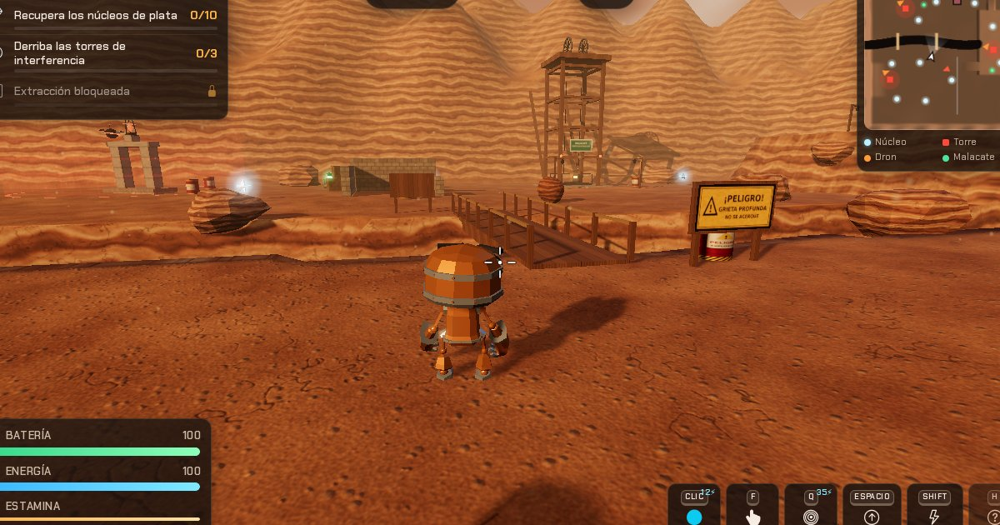

Videojuego 3D de acción en tercera persona para la Web. Controlas a **NOVA-7**, una unidad de asalto blindada, en **Orión IV**: una luna selvática nocturna, cubierta de ruinas de una civilización extinta, donde una mente de cristal llamada **el Eco** «recuerda» todo lo que toca. Campaña de **3 operaciones**, cada una con su **jefe**; la última es el enfrentamiento con el jefe final.

- **Demo:** <https://fertello29.github.io/hale2.0/> (GitHub Pages, sin IA) · versión completa con IA en Vercel (ver [PUBLICAR.md](PUBLICAR.md)).
- **Nuevo en v2.1:** control de NOVA-7 **por voz**, **realidad virtual** (Meta Quest 3 con WebXR y lentes **VR Box** para celular), **IA con OpenAI** para interpretar órdenes y dirigir la táctica (la API key queda oculta en funciones de **Vercel**), soporte para **gamepad** y **dificultad más baja**.
- **Autor:** Fernando Rosales Tello — Ingeniería en Tecnologías de la Información y Comunicaciones, TecNM campus Pachuca. **¿Colaboramos o necesitas un proyecto?** Escríbeme en [LinkedIn](https://www.linkedin.com/in/fernando-rosales-tello-598698349) (también hay un botón *Contactar al desarrollador* en el juego).
- **Sin herramientas de compilación:** HTML + CSS + JavaScript (módulos ES). Three.js y Rapier se cargan desde CDN mediante *import maps*.
- **Universo 100 % original:** historia, personajes, criaturas, armas y escenarios se crearon para este proyecto; no usa nombres, personajes ni diseños de franquicias existentes.

---

## Índice

1. [Historia](#historia)
2. [Campaña](#campaña)
3. [Jefes y enemigos](#jefes-y-enemigos)
4. [Arsenal y habilidades](#arsenal-y-habilidades)
5. [Controles](#controles)
6. [Control por voz](#control-por-voz) · [Gestos con la mano](#gestos-con-la-mano)
7. [Realidad virtual](#realidad-virtual)
8. [Inteligencia artificial (OpenAI + Vercel)](#inteligencia-artificial-openai--vercel)
9. [Mecánicas de juego](#mecánicas-de-juego)
10. [Tecnologías](#tecnologías)
11. [Arquitectura y estructura del proyecto](#arquitectura-y-estructura-del-proyecto)
12. [Física con Rapier 3D](#física-con-rapier-3d)
13. [Modelos, animaciones, texturas, audio y música](#modelos-animaciones-texturas-audio-y-música)
14. [Ejecutar en local](#ejecutar-en-local)
15. [Publicar (Vercel y GitHub Pages)](#publicar-vercel-y-github-pages)
16. [Cumplimiento de requisitos](#cumplimiento-de-requisitos)
17. [Pruebas realizadas](#pruebas-realizadas)
18. [Rendimiento y compatibilidad](#rendimiento-y-compatibilidad)
19. [Créditos y licencias](#créditos-y-licencias)
20. [Historial de versiones](#historial-de-versiones)
21. [Capturas](#capturas)

---

## Historia

> Año 2291. Hace seis meses, la **Expedición Kepler** —cuarenta y dos científicos y sus androides de apoyo— dejó de transmitir desde **Orión IV**. La estación orbital **Vigía** envía a **NOVA-7** a averiguar qué ocurrió. Antes de tocar tierra, algo derriba su nave. Algo que canta en la frecuencia de los cristales: **el Eco**.

La historia se cuenta durante la partida con **diálogos de radio subtitulados**:

| Personaje | Papel |
|---|---|
| **Cmdte. Elena Ruiz** (estación Vigía) | Da las órdenes y las pistas para vencer a cada jefe. |
| **NOVA-7** | La unidad que controlas; responde con lecturas de sus sensores. |
| **Dra. Ibáñez** | Xenobióloga de la Expedición Kepler; sus registros aparecen al recuperar cada celda de energía. |
| **El Eco** | La mente cristalina que corrompió a los androides y criaturas de la luna. |

Al terminar la campaña se muestra un **epílogo** que cierra la historia.

## Campaña

Cada operación tiene una **sesión informativa** (historia, objetivos, hostiles, jefe, equipo y récord), objetivos con progreso en el HUD, un marcador en pantalla hacia el objetivo actual y un **punto de control** antes del jefe.

| Operación | Escenario | Objetivos | Jefe |
|---|---|---|---|
| **1 · Caída en la selva** | *Valle del Descenso*: selva nocturna con río, restos de la nave, una atalaya en ruinas derribable, un claro y un cráter. | Recuperar 3 celdas de energía (posiciones generadas en cada partida) → activar la baliza de rescate (<kbd>E</kbd>) → defenderla 50 s de 3 oleadas sin salir del perímetro → vencer al jefe → abordar la nave de extracción. | **La Matriarca** |
| **2 · El Templo de los Ecos** | *Ruinas de Ashkar*: campo de ruinas, abismo con dos puentes de piedra, gran plaza con columnatas y la fachada del templo. | Cruzar hasta la plaza → destruir los 3 **pilones de resonancia** (a disparos o **derribando su torre de piedra** con física) → la puerta se abre y sale el jefe → entrar al templo. | **El Coloso** |
| **3 · El Corazón del Eco** | *Santuario sobre el abismo*: plataforma circular flotante, pilares de cobertura, anclas de cristal y un puente hacia la nave. | Romper las 4 **anclas de cristal** → destruir el núcleo del Eco → **huir a la nave** con cuenta atrás mientras el puente se desploma losa por losa. | **El Eco (jefe final)** |

**Victoria:** completar los objetivos de cada operación (la tercera cierra la campaña con el epílogo y el puntaje total).
**Derrota:** la integridad de NOVA-7 llega a 0, caer al abismo en el santuario o que termine la cuenta atrás del colapso. La pantalla de derrota explica la causa y permite **reintentar desde el punto de control** (si ya se alcanzó), **reiniciar el nivel** o volver al menú.

**Progreso guardado:** operaciones desbloqueadas y récords por dificultad (en `localStorage`, si el navegador lo permite).

| Dificultad | Vida enemiga | Daño recibido | Número de enemigos | Vida de jefes | Suministros |
|---|---|---|---|---|---|
| Recluta | ×0.65 | ×0.35 | ×0.65 | ×0.6 | ×1.6 |
| Veterano | ×0.85 | ×0.65 | ×0.85 | ×0.8 | ×1.25 |
| Leyenda | ×1.1 | ×1.1 | ×1.05 | ×1.05 | ×0.95 |

En la v2.1 se bajó la dificultad en los tres niveles: además de la tabla, el escudo de NOVA-7 sube de 75 a 90, se recarga antes (2,8 s en lugar de 3,5 s) y más rápido, y los enemigos fallan más (menor precisión). El **director táctico** puede suavizar todavía más la partida si el jugador está en apuros (ver [Inteligencia artificial](#inteligencia-artificial-openai--vercel)).

## Jefes y enemigos

### Jefes

| Jefe | Descripción | Cómo vencerlo |
|---|---|---|
| **La Matriarca** (op. 1) | Madre de los acechadores: 4,5 m de caparazón de cristal sobre seis patas animadas por procedimiento. Emerge del cráter. | Embiste a 15 m/s; si choca contra un **pilar de roca** o un árbol queda **aturdida**. Su punto débil es el **saco luminoso** de la espalda (daño ×3). También escupe ácido (proyectiles balísticos con aviso en el suelo), da zarpazos e invoca acechadores al 66 % y 33 % de vida. |
| **El Coloso** (op. 2) | La excavadora de la expedición fusionada con cristal: un robot de 6,4 m con su propio `AnimationMixer`. | Un **escudo** alimentado por **nodos de cristal** lo hace invulnerable: destrúyelos (los rayos de energía muestran cuáles). Al 50 % se vuelve a blindar con nodos nuevos y llama refuerzos. Da puñetazos, lanza **rocas con física**, dispara andanadas de morteros y golpea el suelo con una onda expansiva que se esquiva **saltando**. Tiro a la cabeza ×2. |
| **El Eco** (final) | Inteligencia cristalina flotante (cuerpo cinemático) con tres fases. | **Fase 1:** cuatro anclas le dan un escudo; lanza orbes teledirigidos (se pueden derribar), lluvia de cristales con aviso y abre portales. **Fase 2:** sin escudo, dispara un **rayo fijador** (se bloquea tras un pilar) y un **anillo de choque** que hay que saltar. **Fase 3 (<35 %):** todo más rápido. Punto débil: el **ojo** (×2). Al morir, el santuario colapsa. |

### Enemigos

| Enemigo | Comportamiento |
|---|---|
| **Acechador** | Criatura de cristal de seis patas (marcha trípode procedural). Corre en zigzag, salta sobre el jugador con un impulso físico real y muerde. Al morir **se hace añicos** en fragmentos con física. |
| **Espectro** (y **Espectro de élite**) | Androide corrompido de la expedición (mismo modelo que NOVA-7 con armadura obsidiana y visor magenta, animaciones Idle/Walk/Run/Punch/Death). Dispara ráfagas de plasma, se mueve lateralmente, mantiene distancia y golpea de cerca. |
| **Centinela** | Dron de cristal cinemático que orbita al jugador y dispara pares de rayos. El pulso de choque lo aturde (daño ×2). Al ser derribado pasa a cuerpo **dinámico**, cae y estalla. |
| **Bastión** | Constructo pesado (350 kg) con **escudo frontal** (−85 % de daño de balas): hay que flanquearlo (espalda ×1,6) o usar explosivos. Lanza morteros con aviso en el suelo y da pisotones. |

La IA percibe al jugador con **raycasts de línea de visión**, se alerta en grupo, **escucha** disparos y explosiones, esquiva obstáculos con raycasts y usa cuerpos dinámicos de Rapier (las explosiones, la singularidad y el pulso los empujan de verdad; al morir caen como muñecos de trapo).

## Arsenal y habilidades

| Tecla | Arma | Detalles |
|---|---|---|
| <kbd>1</kbd> | **Rifle de pulsos RP-12** | Automático, 9,5 disparos/s, 13 de daño (cabeza ×1,8), cargador de 36. Impacto instantáneo por raycast con impulso físico en el punto de impacto. |
| <kbd>2</kbd> | **Dispersor DS-4** | 10 perdigones en cono, cargador de 6. Demoledor a corta distancia. |
| <kbd>3</kbd> | **Lanzaorbes LO-3** | Mantén el clic para **cargar**: el orbe es un proyectil físico (CCD) con trayectoria visible que explota con daño en área e impulso radial. |
| <kbd>4</kbd> | **Rifle de riel RR-1** | 160 de daño (cabeza ×2) que **atraviesa hasta 4 objetivos**; con clic derecho se usa la **mira telescópica** (zoom óptico real). |

| Tecla | Habilidad | Detalles |
|---|---|---|
| <kbd>R</kbd> | **Recargar** | Cada arma tiene cargador y reserva; recarga automática al vaciarse. Munición en cajas y botín. |
| <kbd>G</kbd> (mantener y soltar) | **Granada** | Muestra la trayectoria y el punto de impacto. **Fragmentación:** rebota y explota a los 2,1 s. **Singularidad:** crea un vórtice que atrae cuerpos y enemigos durante 2,8 s y luego implosiona. |
| <kbd>T</kbd> | Cambiar tipo de granada | |
| <kbd>F</kbd> | **Golpe** | Empuja objetos, rompe cajas y aturde enemigos. |
| <kbd>Q</kbd> | **Pulso de choque** | Impulso radial de 7,5 m (recarga de 9 s): aturde y derriba drones. |

**Salud:** escudo recargable (se regenera tras 2,8 s sin recibir daño) + integridad (botiquines). **Estamina** para correr.

## Controles

| Tecla / botón | Acción |
|---|---|
| <kbd>W</kbd> <kbd>A</kbd> <kbd>S</kbd> <kbd>D</kbd> / flechas | Mover (relativo a la cámara) |
| Mouse | Cámara (el primer clic captura el puntero) |
| <kbd>Shift</kbd> | Correr |
| <kbd>Espacio</kbd> | Saltar |
| **Clic izquierdo** | Disparar (con el lanzaorbes: mantener para cargar) |
| **Clic derecho** | Apuntar sobre el hombro · mira del rifle de riel |
| <kbd>1</kbd>–<kbd>4</kbd> / rueda | Cambiar de arma |
| <kbd>R</kbd> | Recargar |
| <kbd>G</kbd> / <kbd>T</kbd> | Granada / tipo de granada |
| <kbd>F</kbd> / <kbd>Q</kbd> | Golpe / pulso de choque |
| <kbd>E</kbd> | Interactuar (baliza, nave) |
| <kbd>H</kbd> | Ayuda con todos los controles |
| <kbd>Esc</kbd> / <kbd>P</kbd> | Pausa |

**Gamepad** (Xbox, PlayStation o el control Bluetooth de un visor VR Box): stick izq. mover · stick der. cámara · RT disparar · LT apuntar · A saltar · B golpe · X recargar · Y siguiente arma · LB granada · RB pulso · L3 correr · R3 interactuar · Start pausa · Select voz.

**Pantallas táctiles:** joystick virtual, arrastre para la cámara y botones de disparo, apuntar, salto, recarga, granada, cambio de arma, golpe, pulso, correr e interactuar. En vertical se pide girar el teléfono. Los controles están visibles en el menú, en la pausa, en el HUD (habilidades y teclas) y en el panel de ayuda (<kbd>H</kbd>).

## Control por voz

Pulsa <kbd>V</kbd> (o el botón 🎙 del HUD, o activa *Comandos de voz* en Ajustes) y habla en español. El reconocimiento usa la **Web Speech API** del navegador (Chrome, Edge, Safari, Chrome para Android). En los navegadores que no la tienen (**Meta Quest Browser**, Firefox) se usa «presiona para hablar»: mientras mantienes <kbd>V</kbd>, el botón 🎙 o **X** en el control izquierdo del Quest, el audio se graba y se transcribe con OpenAI en el servidor.

| Di… | NOVA-7… |
|---|---|
| «avanza», «adelante», «pa'lante», «sigue derecho», «atrás» (+ «3 segundos») | avanza o retrocede (hasta que digas «alto», o el tiempo indicado) |
| «izquierda», «a la derecha», «para la izquierda», «un poco a la derecha» | paso lateral hacia ese lado |
| «gira / voltea / dobla a la izquierda» (+ «45 grados», «un poco») | gira 90° (o lo indicado) |
| «corre» / «camina» | corre o camina |
| «alto», «detente», «para» | se detiene y deja de disparar |
| «dispara», «dispárales», «tírale», «ráfaga», «fuego sin parar», «alto el fuego» | dispara con **apuntado automático** al enemigo visible más conveniente |
| «salta», «recarga», «golpea», «pulso» | acciones |
| «granada», «granada de singularidad» | apunta y lanza una granada |
| «rifle», «dispersor», «lanzaorbes», «riel», «arma 2», «siguiente arma» | cambia de arma |
| «gira a la izquierda 90», «media vuelta», «mira arriba» | gira o inclina la cámara |
| «ve al objetivo», «llévame a la baliza» | **piloto automático** hacia el marcador del objetivo (salta si se atora) |
| «usa», «activa la baliza», «aborda» | interactúa (como <kbd>E</kbd>) |
| «pausa», «continúa», «ayuda», «sal de realidad virtual» | control de la partida |

El intérprete entiende el **español de México** («para la izquierda» es moverse, no detenerse; «pa'lante», «córrele», «brínquele»), conjugaciones y pronombres pegados («dispárales», «voltéate») y **corrige errores del reconocedor** de voz («isquierda» → izquierda) comparando las palabras con las órdenes conocidas. Además, de las alternativas que propone el reconocedor elige la que mejor se entiende.

Varias órdenes se encadenan: «dispara y salta», «gira a la derecha y avanza 2 segundos». Las órdenes cortas («alto», «salta») se ejecutan con el resultado provisional del reconocedor, sin esperar a que termines de hablar. Si el intérprete entiende menos del 60 % de la frase («cúbrete detrás de algo», «flanquea por la derecha»), la **IA** la interpreta usando también las alternativas del reconocedor y lo que entendió el intérprete local (ver más abajo).

Código: `js/ai/VoiceControl.js` (micrófono y modos) y `js/ai/VoiceCommands.js` (intérprete y ejecutor).

## Gestos con la mano

Pulsa <kbd>C</kbd> (o el botón ✋ del HUD, *Activar / apagar la cámara* en el menú, o *Gestos con la mano* en Ajustes). Se enciende la cámara frontal y aparece un panel con **tu imagen en espejo**, el **esqueleto de la mano** detectada y una **guía ilustrada** que resalta el gesto reconocido. El reconocimiento usa **MediaPipe Gesture Recognizer** (Google) en el navegador: el video **se analiza en tu dispositivo y no se envía a ningún servidor**.

| Gesto | Acción |
|---|---|
| ✋ Palma abierta | Avanzar **recto**. Inclínala como un **volante** para girar mientras avanzas |
| ✊ Puño | Detenerse (también detiene lo que ordenaste por voz). Inclínalo para **girar sin avanzar** |
| ☝️ Índice arriba | Disparar mientras lo mantengas, con **apuntado automático** |
| ✌️ Amor y paz | Saltar |
| 👍 Pulgar arriba | Recargar |
| 👎 Pulgar abajo | Retroceder |
| 🤟 Te quiero | Interactuar (baliza, nave), como <kbd>E</kbd> |
| 👈 Señalar a la izquierda (índice de lado) | Moverse a la izquierda |
| 👉 Señalar a la derecha (índice de lado) | Moverse a la derecha |
| 🤙 Llámame (pulgar y meñique) | Correr hacia adelante |
| 👌 OK (pulgar e índice juntos) | Granada: mantén para apuntar y suelta para lanzar |

Los primeros siete gestos los reconoce el modelo de MediaPipe. Los cuatro últimos son **gestos propios**: el juego los calcula con los 21 puntos de la mano (`classifyHand`), según qué dedos están estirados y hacia dónde apunta el índice.

**Girar la cámara con la mano:** inclina la palma (o el puño) hacia un lado, como un volante. Hasta unos 18° no gira (la inclinación natural de la mano), y gira más rápido cuanto más la inclinas. El panel de la cámara muestra el volante con una aguja. La posición de la mano en la imagen ya no importa: antes, con la mano a un lado, NOVA-7 daba vueltas en círculo.

**Apuntado automático** (voz y gestos): al disparar con «dispara» o ☝️ se elige el mejor blanco con tiro limpio (sin terreno ni objetos de por medio), prefiriendo el más cercano y el que está al frente. Si el jefe tiene escudo, apunta a los nodos o anclas que lo alimentan, y derriba los orbes del Eco que se acercan. La cámara y NOVA-7 giran hacia el blanco y se dispara con la precisión de «apuntando». Se desactiva en *Ajustes → Apuntado automático*. En el visor VR solo corrige la bala, sin girar tu vista.

Puedes usar **las dos manos** a la vez (✋ con una para avanzar y ☝️ con la otra para disparar) y combinar los gestos con el teclado o la voz. Para que funcione bien, coloca la mano a unos 30–60 cm de la cámara y con buena luz. Dentro de los visores VR se desactiva, porque la cámara no ve las manos. La primera vez se descargan unos 18 MB (modelo y WebAssembly), que el navegador guarda en caché.

Código: `js/ai/GestureControl.js`.

## Realidad virtual

### Meta Quest 3 (WebXR)

Abre el juego en el navegador del Quest → elige una operación → **Jugar en visor VR** (también en la pausa: **Continuar en visor VR**).

- Vista en **tercera persona** (detrás de NOVA-7) o **primera persona** (clic en el stick derecho o en Ajustes; marea menos).
- Caminas hacia donde miras, **giro por pasos de 30°** para evitar mareo y apuntas con el **láser del control derecho** (retícula roja sobre enemigos). Los controles vibran al disparar, al acertar y al recibir daño.
- HUD 3D bajo la mirada: objetivo, escudo, integridad, munición, jefe, radio y voz.

| Control izquierdo | | Control derecho | |
|---|---|---|---|
| Stick | Mover | Gatillo | Disparar |
| Clic del stick | Correr | Grip | Golpe |
| Gatillo | Granada (mantener y soltar) | A | Saltar |
| Grip | Interactuar / pulso | B | Recargar |
| X (mantener) | Hablar (voz) | Stick ←/→ | Girar 30° |
| Y | Pausa | Stick ↑/↓ | Cambiar arma |
| | | Clic del stick | 1.ª / 3.ª persona |

En pausa: gatillo derecho o Y para continuar, B para salir de VR. Al terminar o perder una operación se sale de VR para mostrar los resultados.

### Lentes VR Box para celular

En el celular: elige una operación → **Lentes VR Box** → acepta giroscopio y micrófono → coloca el teléfono en horizontal en el visor.

- Pantalla dividida en estéreo (`StereoEffect`) y cámara controlada por el **giroscopio** (`DeviceOrientationEvent`).
- Como no puedes tocar los controles con el teléfono dentro del visor, la **voz** se activa sola: «avanza», «ve al objetivo», «dispara», «alto». También puedes **tocar la pantalla** (o el botón del visor) para disparar, o usar un **control Bluetooth**.
- Di «pausa» para salir del estéreo y ver el menú.

Código: `js/xr/XRMode.js`, `js/xr/CardboardMode.js`, `js/xr/VRHud.js`.

## Inteligencia artificial (OpenAI + Vercel)

La IA toma dos tipos de decisiones:

1. **Director táctico** (`js/ai/TacticalAI.js`): cada 20 s envía un resumen de la partida (salud, escudo, daño reciente, enemigos cerca, munición, jefe y su vida) y la IA **decide** cuánto daño y puntería tienen los enemigos, cuántos suministros sueltan y si llegan refuerzos completos. También decide si la estación Vigía **lanza un botiquín, munición o granadas** junto a NOVA-7 y qué **consejo táctico** da la Cmdte. Ruiz por radio (por ejemplo, el punto débil del jefe). Todo valor se acota en el cliente: la IA **solo puede facilitar** la partida, nunca hacerla más difícil que la dificultad elegida.
2. **Interpretación de órdenes** (`/api/command`): convierte frases libres en acciones válidas del juego.

Sin servidor de IA (GitHub Pages, sin Internet), ambas funciones siguen trabajando con **lógica local**: el intérprete de órdenes en español y una heurística que toma las mismas decisiones tácticas.

**API key oculta:** el navegador nunca ve la clave. Llama a funciones serverless de **Vercel** (`api/`), que la leen de la variable de entorno `OPENAI_API_KEY`:

| Endpoint | Uso | Modelo |
|---|---|---|
| `GET /api/health` | ¿Hay servidor y clave? (nunca devuelve la clave) | — |
| `POST /api/command` | Frase → acciones `{ do: 'move', dir: 'back' }`… | `gpt-4o-mini` (configurable) |
| `POST /api/tactics` | Estado de la partida → decisión táctica | `gpt-4o-mini` |
| `POST /api/transcribe` | Audio → texto (Quest, Firefox) | `whisper-1` |

Las funciones solo aceptan peticiones desde el propio dominio (más `ALLOWED_ORIGINS`), limitan las solicitudes por IP, acotan el tamaño de las entradas y responden JSON validado. Guía de despliegue: **[PUBLICAR.md](PUBLICAR.md)**.

## Mecánicas de juego

### HUD

Objetivos con progreso · barra del jefe (con indicador de escudo y nodos restantes) y avisos de ataques («¡SALTA!») · temporizador y barra de progreso · minimapa (terreno horneado por nivel, enemigos alertados, objetivos, jefe) · puntaje con conteo progresivo · registro de bajas · escudo, integridad y estamina · habilidades con anillo de recarga · arma, munición, recarga, ranuras 1–4 y granadas · mira dinámica según el arma (se ensancha con la dispersión, se pone roja sobre enemigos, anillo de carga) · marcador de impacto (cabeza en dorado, baja en rojo) · indicadores de dirección del daño · números de daño · marcador del objetivo en pantalla con distancia · subtítulos de radio · pistas de controles · avisos y carteles.

### Interacciones

Disparo instantáneo (raycast), disparo perforante, proyectiles balísticos cargados, granadas que rebotan, vórtice gravitatorio, golpe, pulso radial, recoger objetos (sensores), romper cajas de suministros, detonar cápsulas de plasma (también en cadena), derribar estructuras, empujar objetos al caminar (el controlador cinemático aplica impulsos), activar la baliza y abordar la nave (<kbd>E</kbd>).

### Objetos con física

Cajas militares apilables · cajas de suministros rompibles (sueltan botín) · cápsulas de plasma explosivas · bloques de piedra (atalaya, columnas de tambores, pilones, losas del puente) · rocas lanzadas por el Coloso y que caen durante el colapso · fragmentos de metal y de cristal · orbes, granadas y proyectiles enemigos · enemigos como cuerpos dinámicos y drones que pasan de cinemáticos a dinámicos.

### Estructuras derribables

- **Atalaya en ruinas** (op. 1): dos pilares de bloques, dintel y remate.
- **Pilones de resonancia** (op. 2): torres de 4 bloques coronadas por un cristal dinámico. Si la torre cae (explosiones, singularidad, orbes, golpes) y el cristal se desplaza, el pilón cuenta como destruido (+500 «¡física!»).
- **Columnas de tambores** de la plaza (op. 2).
- **Puente del santuario** (op. 3): en la huida, cada losa estática se reemplaza por un cuerpo dinámico que cae al abismo.

### Generación dinámica en posiciones válidas

`Spawner.js` coloca celdas de energía, cajas de suministros y enemigos solo si el punto: no está sobre el abismo ni bajo el agua, tiene pendiente caminable, un **raycast vertical** encuentra suelo firme (terreno o estructura), una **consulta de superposición** confirma que el hueco está libre (muros, objetos, enemigos, otros pickups) y respeta la distancia mínima al jugador. Las oleadas entran escalonadas por portales, en cantidad ajustada a la dificultad. El botín se ajusta a la situación (más munición si te falta, más botiquines si estás herido).

### Parámetros configurables (Ajustes)

| Parámetro | Efecto real |
|---|---|
| **Gravedad de Orión IV** (2 – 25 m/s²) | Cambia `world.gravity` de Rapier en caliente: altura del salto, arcos de granadas y orbes, caída de enemigos, escombros y rocas. |
| **Dificultad** | Vida y daño enemigos, número de enemigos, vida de jefes, precisión y suministros. |
| Trayectoria, números de daño, sensibilidad, campo de visión, invertir eje Y, sombras, *bloom*, volumen de efectos y de música | Interfaz, cámara, render y audio. |

### Puntuación

Bajas (acechador 60, centinela 80, espectro 100, bastión 250, tiro a la cabeza +50) · celdas +200 · pilones +500 · objetivos · bonos al completar: nivel +1500, tiempo (hasta +3000), integridad (+5 por punto) y precisión (hasta +1000). Rango por operación **S/A/B/C** y rango de campaña al jugar las tres seguidas.

## Tecnologías

| Tecnología | Versión | Uso |
|---|---|---|
| [Three.js](https://threejs.org) | 0.170.0 | Render WebGL 2, `GLTFLoader`, `AnimationMixer`, `SkeletonUtils`, `InstancedMesh`, `EffectComposer` + `UnrealBloomPass`, `PMREMGenerator`, shaders personalizados (`onBeforeCompile` y `ShaderMaterial`). |
| [Rapier 3D](https://rapier.rs) (`@dimforge/rapier3d-compat`) | 0.14.0 | Gravedad, cuerpos dinámicos/fijos/cinemáticos, colliders (trimesh, cápsula, esfera, cilindro, caja), sensores, CCD, grupos de colisión, eventos, impulsos, `KinematicCharacterController`, raycasts y consultas de superposición. |
| [Bootstrap](https://getbootstrap.com) | 5.3.3 | HUD, pantallas, modales, formularios de ajustes, diseño responsivo. |
| [Bootstrap Icons](https://icons.getbootstrap.com) | 1.11.3 | Iconografía. |
| Web Audio API | nativa | Efectos de sonido sintetizados y música procedural adaptativa. |
| Canvas 2D | nativa | Minimapa y HUD de realidad virtual. |
| WebXR Device API | nativa | Realidad virtual en Meta Quest (`renderer.xr`, controles Touch, vibración). |
| `StereoEffect` + DeviceOrientation | Three.js r170 / nativa | Lentes VR Box para celular. |
| Web Speech API · MediaRecorder | nativa | Comandos de voz y «presiona para hablar». |
| Gamepad API | nativa | Controles Xbox, PlayStation y Bluetooth. |
| MediaPipe Tasks Vision (Gesture Recognizer) | 0.10.14 | Gestos de la mano con la cámara, en el dispositivo. |
| OpenAI API (`gpt-4o-mini`, `whisper-1`) | — | Director táctico, interpretación de órdenes y transcripción. |
| Vercel Functions | Node.js 18+ | Backend que oculta la API key (`api/`). |
| Python + NumPy/SciPy/Pillow | — | Generación de texturas (`tools/generate_textures.py`). |
| Node.js + `GLTFExporter` | — | Exportación de `props.glb` (`tools/build-props.mjs`). |

**Import map** (en `index.html`):

```html
<script type="importmap">
{
  "imports": {
    "three": "https://cdn.jsdelivr.net/npm/three@0.170.0/build/three.module.js",
    "three/addons/": "https://cdn.jsdelivr.net/npm/three@0.170.0/examples/jsm/",
    "@dimforge/rapier3d-compat": "https://cdn.jsdelivr.net/npm/@dimforge/rapier3d-compat@0.14.0/rapier.es.js"
  }
}
</script>
```

La versión *compat* de Rapier trae el WebAssembly embebido, por lo que funciona en GitHub Pages sin configurar tipos MIME.

## Arquitectura y estructura del proyecto

```
hale2.0/                           (nombre del repositorio)
├── index.html                     # Import map, HUD, pantallas y modales
├── css/  fonts.css · main.css · hud.css · screens.css
├── js/
│   ├── main.js                    # Punto de entrada
│   ├── config.js                  # Grupos de colisión, armas, granadas, dificultades, puntaje
│   ├── core/        Game.js (estados, campaña, bucle) · AssetLibrary.js · Input.js · GamepadInput.js · Settings.js · EventBus.js
│   ├── ai/          AIClient.js · TacticalAI.js · VoiceControl.js · VoiceCommands.js · GestureControl.js
│   ├── xr/          XRMode.js (Meta Quest) · CardboardMode.js (VR Box) · VRHud.js
│   ├── physics/     PhysicsWorld.js (paso fijo, interpolación, eventos, raycasts, impulsos)
│   ├── world/       TerrainField.js · Terrain.js · Environment.js · Vegetation.js · PropFactory.js
│   ├── levels/      LevelBase.js · Level1.js · Level2.js · Level3.js
│   ├── entities/    Entity.js · Player.js · Rig.js · Props.js · Pickups.js · Projectiles.js · Interactables.js
│   ├── enemies/     Enemy.js · Acechador.js · Espectro.js · Centinela.js · Bastion.js
│   ├── bosses/      Matriarca.js · Coloso.js · Eco.js
│   ├── weapons/     WeaponSystem.js
│   ├── gameplay/    Damage.js · Spawner.js · EnemyDirector.js · AutoAim.js · Radio.js · Story.js
│   ├── camera/      ThirdPersonCamera.js
│   ├── fx/          Effects.js · AudioManager.js (efectos + MusicDirector)
│   └── ui/          HUD.js · Minimap.js · Screens.js · TouchControls.js
├── api/                           # Funciones de Vercel: health · command · tactics · transcribe
├── server/ai.js                   # OpenAI, CORS y límite de solicitudes (solo en el servidor)
├── assets/  models/ (RobotExpressive.glb, props.glb) · textures/ · fonts/ · img/
├── docs/screenshots/              # Capturas de este README
├── tools/                         # Regenerar texturas y props.glb
└── README.md · PUBLICAR.md · LICENSE · package.json · vercel.json · .env.example · .vercelignore · .editorconfig · .gitignore · .nojekyll
```

### Programación orientada a objetos

- `Entity` → `PhysicsEntity` → `Enemy` → `Acechador`, `Espectro`, `Bastion`, `Matriarca`, `Coloso`.
- `PhysicsEntity` → `Centinela`, `Eco`, `Crate` → `SupplyCrate`, `Canister`, `StoneOrb`, `StoneBlock`, `Debris`, `PlasmaOrb`, `Grenade`, `EnemyBolt`, `Lob`, `HomingOrb`.
- `Entity` → `Player`, `Pickup` (`HealthPack`, `AmmoPack`, `GrenadePack`, `EnergyCell`, `WeaponPickup`), `RescueBeacon`, `Dropship`, `CrystalNode`, `ResonancePylon`, `TempleGate`, `Singularity`.
- `LevelBase` → `Level1`, `Level2`, `Level3` (cada nivel define su terreno, decorado y guion).
- Sistemas desacoplados por `EventBus`: los niveles y enemigos emiten eventos (`enemy:killed`, `objectives:set`, `radio:line`, `boss:show`…) y `HUD`, `AudioManager` y `Screens` reaccionan.

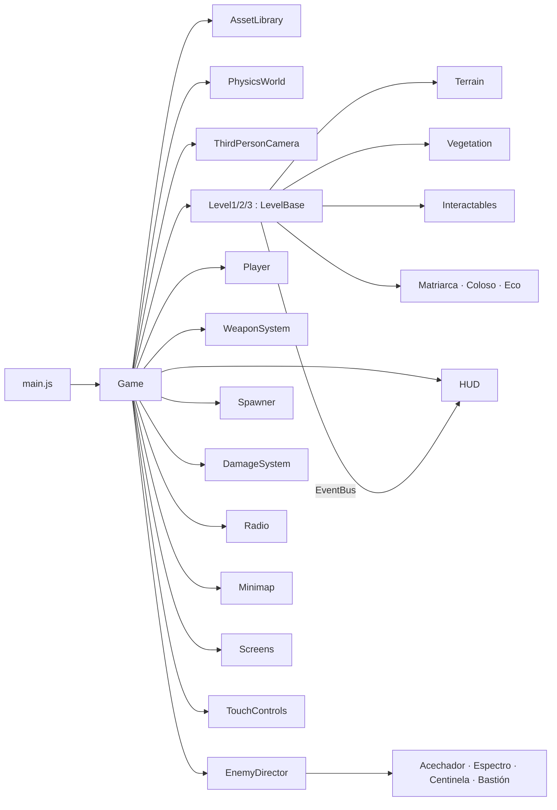

### Estados del juego

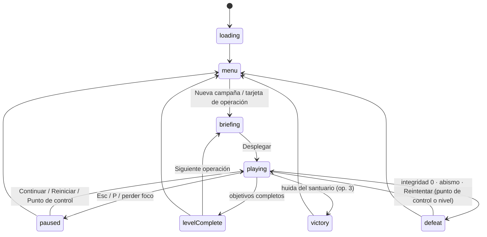

### Bucle principal (por cuadro)

1. Entrada (cámara, pausa, ayuda, interacción).
2. Física con **paso fijo de 1/60 s** (acumulador, máx. 4 subpasos): `fixedUpdate` de jugador, enemigos y proyectiles → `world.step()` → despacho de eventos de colisión.
3. Armas, director de enemigos (oleadas), radio; `update` de entidades (IA, animación); **interpolación** visual; guion del nivel.
4. Cámara, entorno, partículas, HUD, minimapa, música adaptativa y render (con *bloom* opcional).

Un error en una entidad se registra una sola vez en la consola y no congela el juego.

## Física con Rapier 3D

| Elemento | Implementación |
|---|---|
| Gravedad | `new RAPIER.World({x:0, y:-g, z:0})`, modificable desde Ajustes en caliente. |
| Terreno | Collider **trimesh** con los mismos triángulos que la malla visual (función de altura por nivel). |
| Escenario | Colliders fijos de caja, cilindro y cápsula (ruinas, columnas, árboles, hongos, pilares, nave, puerta del templo). |
| Jugador | Cuerpo cinemático + cápsula + `KinematicCharacterController` (pendiente máx. 52°, autoescalón, pegado al suelo, empuje de cuerpos dinámicos). |
| Enemigos y jefes | Cuerpos **dinámicos** con rotaciones bloqueadas y control de velocidad; al morir se desbloquean (muñeco de trapo). Resistencia al empuje configurable para jefes. |
| Drones y Eco | `kinematicPositionBased`; los drones derribados pasan a `Dynamic` con `setBodyType`. |
| Proyectiles | Dinámicos con **CCD**; granadas con rebote y fricción; proyectiles balísticos calculados para caer en el punto avisado. |
| Recogibles | **Sensores** con `ActiveCollisionTypes.KINEMATIC_FIXED` para detectar la cápsula cinemática. |
| Eventos | `EventQueue` + `ActiveEvents.COLLISION_EVENTS` → `onCollide()` de cada entidad. |
| Impulsos | `applyImpulse`, `applyImpulseAtPoint` (balas), `applyTorqueImpulse`, impulso radial (explosiones, pulso), atracción de la singularidad. |
| Consultas | `castRayAndGetNormal` (mira, balas, línea de visión, cámara, validación de spawns, choques de la Matriarca), raycast perforante (riel), `intersectionsWithShape` (golpe, explosiones, holgura). |
| Grupos de colisión | `WORLD`, `PLAYER`, `PROP`, `ORB`, `BOLT`, `DRONE`, `PICKUP`, `DEBRIS`, `ENEMY`, `BOSS` (p. ej., los proyectiles enemigos no dañan a otros enemigos y los cadáveres no estorban al caminar). |

## Modelos, animaciones, texturas, audio y música

### Personajes y animaciones (`AnimationMixer`)

`RobotExpressive.glb` (CC0) se carga con `GLTFLoader`, se clona con `SkeletonUtils` y se «viste» con piezas de armadura de `props.glb` enganchadas a los huesos (`Rig.js`). Con él se construyen **NOVA-7**, los **Espectros** y el **Coloso** (escalado a 6,4 m), cada uno con su paleta.

| Clip | Uso |
|---|---|
| `Idle`, `Walking` (también hacia atrás), `Running` | Locomoción con fundidos cruzados y fase sincronizada |
| `Jump` | Salto, caída, pulso de choque y pisotón del Coloso |
| `Punch` | Golpe, lanzamiento de granada, ataques cuerpo a cuerpo y lanzamiento de rocas del Coloso |
| `Death` | Derrota de NOVA-7, muerte de Espectros y del Coloso |
| `Dance`, `Wave` | Operación completada, menú y abordaje |
| `No`, `Yes` | Rugido del Coloso al reactivarse y andanada de morteros |

Además: **brazo que apunta** el arma hacia la mira (cinemática inversa sencilla sobre `UpperArmR`/`LowerArmR`), arma en la mano orientada al objetivo, *morph targets* faciales (`Surprised`, `Sad`, `Angry`) y **patas procedurales** (marcha trípode) para acechadores y la Matriarca.

### Utilería 3D (`props.glb`)

`tools/build-props.mjs` construye por código los modelos de `js/world/PropFactory.js` (4 armas + lanzador enemigo, granadas, celdas, botiquín, munición, armadura, acechador, Matriarca, centinela, bastión, núcleo del Eco, nave, baliza, puerta del templo, cristales y faroles) y los exporta con `GLTFExporter`. El juego los carga con `GLTFLoader`; si el archivo faltara, usa `PropFactory` como respaldo.

### Texturas y shaders

`tools/generate_textures.py` genera las texturas *tileables* (suelo de selva, roca alienígena con vetas luminosas, piedra de ruinas con glifos emisivos, corteza, paneles metálicos, cajas militares, cápsulas, helechos y pasto con transparencia). Shaders propios: terreno (mezcla por pendiente, proyección triplanar, vetas que pulsan, oscurecimiento en abismos), cielo (estrellas, dos lunas, auroras, tinte de tensión), esporas bioluminiscentes, viento en la vegetación instanciada; el agua del río usa un mapa normal animado.

### Audio y música

Todos los sonidos se **sintetizan con Web Audio** (armas, impactos, recargas, criaturas, jefes, radio, interfaz) con atenuación por distancia y paneo estéreo, más un ambiente de selva. La **música es procedural y adaptativa**: un secuenciador con pads, arpegios, bajo y percusión que sube de intensidad al entrar en combate y en los jefes. No hay archivos de audio.

### Regenerar recursos (opcional)

```bash
python tools/generate_textures.py   # requiere numpy, scipy y pillow
npm run props                       # requiere Node.js 18+
```

## Ejecutar en local

Los módulos ES y los GLB **no funcionan abriendo `index.html` con doble clic** (`file://`); el juego lo detecta y muestra instrucciones. Usa un servidor estático:

- **VS Code:** clic derecho en `index.html` → *Open with Live Server*.
- **Node.js:** `npx http-server . -p 8080 -c-1` (o `npm start`) → `http://localhost:8080`.
- **Python:** `python -m http.server 8080` → `http://localhost:8080`.

Se necesita Internet para descargar Three.js, Rapier y Bootstrap desde jsDelivr. Agrega `?debug` a la URL para exponer `window.game` en la consola (por ejemplo, `game.voice.handleText('avanza')`) y `?vrbox` para mostrar el botón de lentes VR Box en una PC.

**Con IA en local:** copia `.env.example` como `.env.local`, pon tu clave y ejecuta `npm run ia-local` (`vercel dev`, en `http://localhost:3000`). Sin `.env.local`, el juego funciona igual con la lógica local.

## Publicar (Vercel y GitHub Pages)

La guía paso a paso está en **[PUBLICAR.md](PUBLICAR.md)**. Resumen:

1. **Vercel (con IA):** importa el repositorio en Vercel (preset *Other*, sin build), agrega `OPENAI_API_KEY` en *Environment Variables* y despliega. Cada `push` a `main` se vuelve a publicar.
2. **GitHub Pages (sin IA):** *Settings → Pages → Deploy from a branch → `main` / root*. Queda en <https://fertello29.github.io/hale2.0/>. Para usar la IA desde ahí, pon la URL de Vercel en `AI.baseUrl` (`js/config.js`).

Todas las rutas son **relativas**, así que el juego funciona en la raíz de Vercel y en la subcarpeta `/hale2.0/` de GitHub Pages.

## Cumplimiento de requisitos

| Requisito | Implementación | Archivo(s) |
|---|---|---|
| Three.js por CDN e import maps | Import map con Three.js r170, addons y Rapier desde jsDelivr | `index.html` |
| GLTFLoader | Robot animado (jugador, espectros, Coloso) y `props.glb` | `core/AssetLibrary.js`, `entities/Rig.js` |
| AnimationMixer con ≥ 4 animaciones | Idle, Walking, Running, Jump, Punch, Death, Dance, Wave, No, Yes con fundidos | `entities/Rig.js`, `Player.js`, `enemies/Espectro.js`, `bosses/Coloso.js` |
| Cámara en tercera persona con mouse | Órbita con pointer lock, hombro, modo apuntar, mira telescópica, retroceso, colisión y sacudidas | `camera/ThirdPersonCamera.js` |
| Rapier: gravedad, cuerpos, colliders, colisiones, impulsos | Mundo con paso fijo, 5 formas de collider, sensores, CCD, grupos, eventos, impulsos, KCC | `physics/PhysicsWorld.js` y entidades |
| Personaje controlable con teclado | Caminar, correr, saltar, disparar, recargar, granadas, golpe, pulso | `entities/Player.js`, `weapons/WeaponSystem.js` |
| Escenario propio con iluminación, materiales, texturas y obstáculos | 3 escenarios nocturnos (selva, ruinas, santuario) con luz lunar y sombras, niebla, cielo por shader, vegetación instanciada, texturas generadas | `world/*`, `levels/*` |
| ≥ 4 tipos de objetos con física | Más de 10 (ver lista) | `entities/*`, `enemies/*` |
| Estructura derribable | Atalaya, pilones de resonancia, columnas de tambores, puente que colapsa | `levels/*`, `entities/Interactables.js` |
| Lanzamiento / disparo / ataque | 4 armas, granadas de 2 tipos, golpe y pulso | `weapons/WeaponSystem.js`, `entities/Projectiles.js` |
| ≥ 3 tipos de interacción | Más de 10 (ver lista) | varios |
| Parámetro configurable que cambia el juego | Gravedad en caliente, dificultad, etc. | `core/Settings.js`, `ui/Screens.js` |
| Generación dinámica en posiciones válidas | Raycast + pendiente + holgura + abismo/agua + distancia | `gameplay/Spawner.js`, `gameplay/EnemyDirector.js` |
| Misión con objetivos, progreso y puntuación | 3 operaciones con objetivos, progreso, puntaje, rango y récords | `levels/*`, `ui/HUD.js` |
| Victoria y derrota | Por operación y de campaña; derrota con causa explicada | `levels/LevelBase.js`, `core/Game.js` |
| Pantallas de inicio, victoria, derrota y reinicio | Menú con campaña, sesión informativa, pausa, operación completada, victoria final con epílogo, derrota con reintento | `ui/Screens.js`, `index.html` |
| HUD moderno, controles visibles, responsivo con Bootstrap 5 | HUD completo, minimapa, ayuda, modales, diseño táctil | `index.html`, `css/*`, `ui/*` |
| Código organizado y POO | 55 módulos ES con clases y herencia | `js/` |
| Repositorio, commits y publicación | Historial por funcionalidad, GitHub Pages y Vercel | `.git/`, `vercel.json`, `PUBLICAR.md` |
| Control por voz | Web Speech API + intérprete en español + IA para frases libres | `ai/VoiceControl.js`, `ai/VoiceCommands.js` |
| Control con gestos de la mano | Cámara + MediaPipe en el dispositivo, vista previa con esqueleto y guía ilustrada | `ai/GestureControl.js` |
| Realidad virtual | WebXR (Meta Quest) y estéreo con giroscopio (VR Box) | `xr/*` |
| IA para la toma de decisiones | Director táctico con OpenAI y respaldo local | `ai/TacticalAI.js`, `api/tactics.js` |
| API key oculta | Funciones serverless de Vercel con variables de entorno | `api/*`, `server/ai.js` |
| README completo | Este documento | `README.md` |

## Pruebas realizadas

Se probó en **Chromium sin interfaz** (render por software SwiftShader) sirviendo exactamente las versiones de las librerías del import map, con scripts automatizados de Playwright:

- carga sin errores en consola y llegada al menú; verificación de que cada `import` apunta a una exportación existente;
- **operación 1 completa:** zonas de enemigos que aparecen al acercarse, disparo con impacto y tiro a la cabeza, recarga, granada, pulso, recoger el dispersor, 3 celdas → baliza → 3 oleadas → temblor → la Matriarca (estados de acecho, zarpazo, escupitajo, embestida y **aturdimiento al chocar con un pilar**; saco ×3) → nave que aterriza → abordaje → pantalla de operación completada;
- **operación 2 completa:** plaza, pilón destruido a disparos, **pilón derribado con explosiones**, puerta que se abre, el Coloso (escudo que anula el daño, nodos, segunda fase con 3 nodos y refuerzos), entrada al templo;
- **operación 3 completa:** activación del Eco al pisar la arena, 4 anclas → fase 2 (anillo de choque, ojo ×2) → fase 3 → muerte → huida con cuenta atrás, losas del puente que caen como cuerpos dinámicos → **victoria final** con epílogo;
- lanzaorbes cargado, rifle de riel con mira, dispersor, granada de singularidad (atracción + implosión), bastión (−85 % de frente, ×1,6 por la espalda), centinela que cae y estalla al morir;
- daño real hasta la **derrota** (causa mostrada), **reintento desde el punto de control**, reinicio, pausa, cambio de **gravedad** (se refleja en `world.gravity`), paso a la siguiente operación;
- diseño en 1280×720, 844×390 táctil horizontal y 390×844 táctil vertical (aviso de girar el teléfono).

**v2.1 (voz, VR e IA):**

- 29 casos del intérprete de voz y la validación de acciones (incluye entradas maliciosas de la IA, que se descartan o acotan).
- Las 4 funciones de Vercel con OpenAI simulado: CORS, rechazo de otros orígenes (403), límite de solicitudes (429), JSON inválido, audio no válido y que la clave nunca aparezca en las respuestas.
- Partida en Chrome (con GPU) dirigida por voz: «avanza», «alto», «dispara», «gira a la izquierda 90», «salta», «recarga», «ve al objetivo» (se acerca al marcador) y una frase libre interpretada por la IA; el director táctico baja el daño enemigo y lanza un botiquín; los temporizadores se congelan en pausa y se cancelan al reiniciar el nivel; modo VR Box con giroscopio simulado (45° de giro del teléfono = 45° de cámara), HUD 3D y salida con «pausa»; sin errores en la consola.
- **Gestos (v2.2):** Chrome con una cámara falsa que reproduce fotos reales de manos (muestras públicas de MediaPipe). Reconoce ☝️, ✌️ y 👍 y ejecuta disparo, salto y recarga; los gestos propios se probaron con manos sintéticas (11 casos) y con fotos reales giradas 90° (☝️ de lado → 👈/👉): NOVA-7 se mueve de lado, corre con 🤙 y apunta y lanza la granada con 👌; con ✋ simulada avanza y gira hacia el lado de la mano; ✊ lo detiene; la pausa suelta las acciones; <kbd>C</kbd> apaga la cámara; sin errores en la consola. En una foto de muestra con la mano pequeña y lejana, el detector no encontró la mano: por eso la interfaz pide acercarla a 30–60 cm.
- **No probado en hardware real:** no hubo un Meta Quest ni un teléfono con visor disponibles. WebXR se verificó solo en su inicialización. El mapeo de botones sigue el perfil estándar `xr-standard` de los controles Touch, pero conviene probarlo en el visor.

> **Notas honestas:** muchas de estas pruebas usaron invulnerabilidad, teletransporte y daño forzado para recorrer cada flujo rápido; el equilibrio de dificultad está pensado para jugarse a mano y puede requerir ajustes. En el navegador automatizado la tasa de cuadros no es representativa (render por software) y el audio no se escuchó, solo se verificó que no produjera errores. No se probó en Safari ni en teléfonos físicos.

## Rendimiento y compatibilidad

- Navegadores con **WebGL 2**: Chrome, Edge y Firefox recientes (Safari 15+ debería funcionar).
- Recomendado: mouse y teclado. En tabletas y teléfonos funciona con controles táctiles en horizontal.
- Optimizaciones: paso de física fijo con interpolación, vegetación con `InstancedMesh`, enemigos que aparecen por zonas, luces de efectos de un *pool* fijo (sin recompilar shaders), partículas en dos `THREE.Points`, trazadoras y fogonazos de *pools* fijos, shaders precompilados al cargar, sombra que sigue al jugador y *pixel ratio* limitado a 1.75.
- Si va lento: desactiva *Sombras dinámicas* o *Resplandor* en Ajustes.

## Créditos y licencias

| Recurso | Autor | Licencia |
|---|---|---|
| Código, historia, personajes y diseños | Fernando Rosales Tello | MIT (`LICENSE`) |
| `RobotExpressive.glb` | [Tomás Laulhé (Quaternius)](https://www.patreon.com/quaternius), modificaciones de [Don McCurdy](https://donmccurdy.com/) (ejemplos de Three.js) | CC0 1.0 |
| `props.glb`, texturas, logo y portada | Generados por procedimiento para este proyecto | CC0 1.0 |
| Three.js | three.js authors | MIT |
| Rapier 3D | Dimforge | Apache-2.0 |
| Bootstrap y Bootstrap Icons | The Bootstrap Authors | MIT |
| Chakra Petch, Saira Stencil One | Google Fonts (vía Fontsource) | SIL OFL 1.1 (`assets/fonts/OFL.txt`) |
| Efectos de sonido y música | Sintetizados en tiempo real con Web Audio | — |

## Historial de versiones

- **v1.0 — «Veta Airosa»:** primera entrega (cañón minero, un nivel, drones y torres). Sus commits siguen en el historial.
- **v2.0 — «Eco de Orión»:** nuevo universo original, campaña de 3 operaciones con jefes, 4 enemigos, 4 armas con recarga, 2 granadas, radio y música adaptativa. Commits por funcionalidad (`git log --oneline`).
- **v2.4:** voz para el español de México («para la izquierda», «pa'lante», «dispárales») con corrección de errores del reconocedor y más ayuda de la IA; volante con la mano para girar (✋ avanza recto); apuntado automático al disparar con voz o gestos.
- **v2.3:** gestos para moverse a la izquierda y derecha, correr y lanzar granadas, y botón de contacto (LinkedIn).
- **v2.2:** control con gestos de la mano frente a la cámara (MediaPipe), con vista previa en espejo, esqueleto de la mano y guía ilustrada.
- **v2.1:** control por voz, realidad virtual (Meta Quest con WebXR y VR Box), director táctico e intérprete de órdenes con OpenAI a través de Vercel (API key oculta), gamepad, dificultad más baja y temporizadores en tiempo de juego (corrige proyectiles y efectos que podían aparecer en el nivel siguiente al reiniciar o salir al menú).

## Capturas

| | |
|---|---|
| 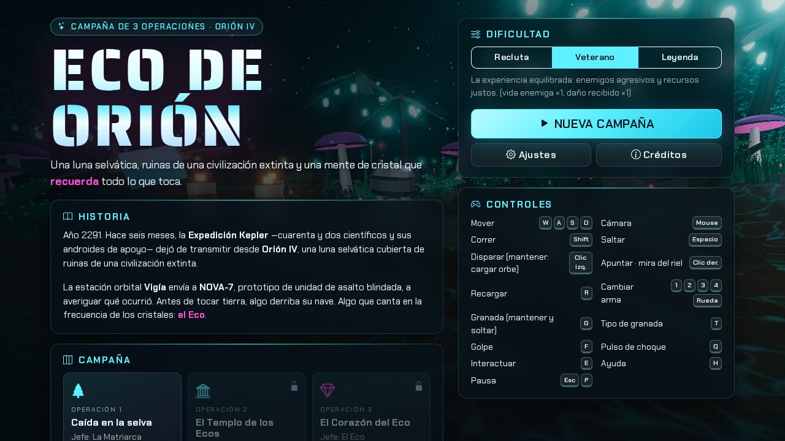 | 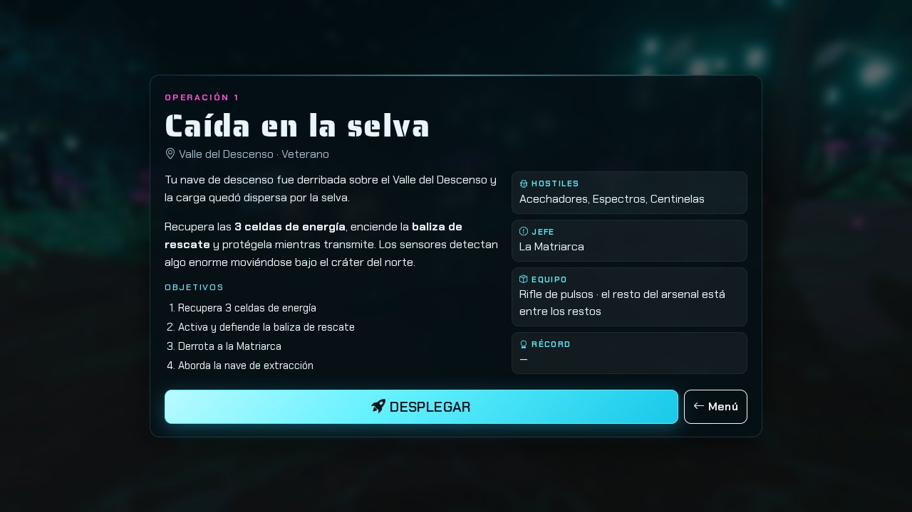 |
| 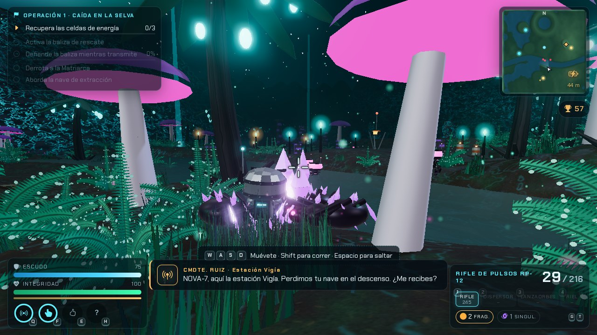 | 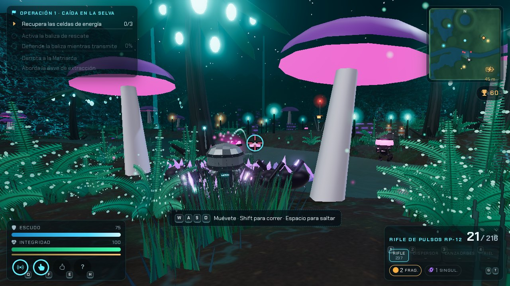 |
| 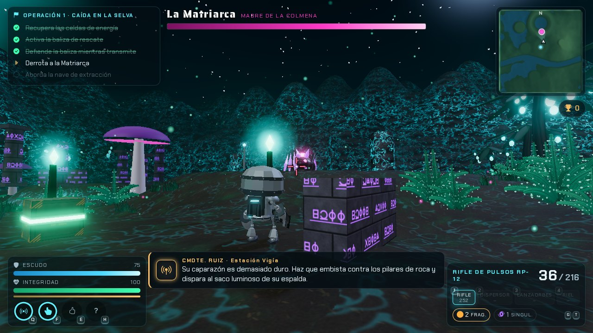 | 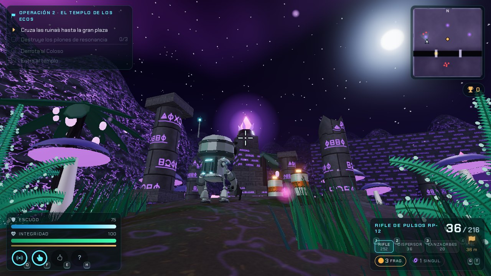 |
| 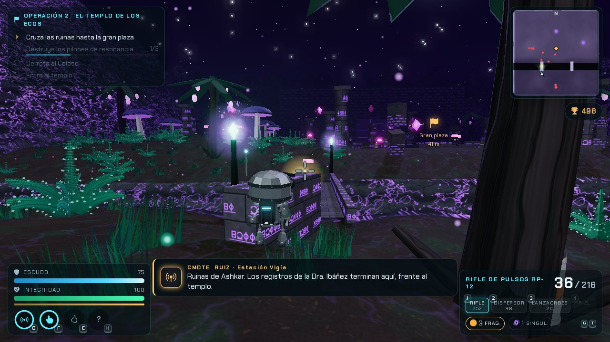 | 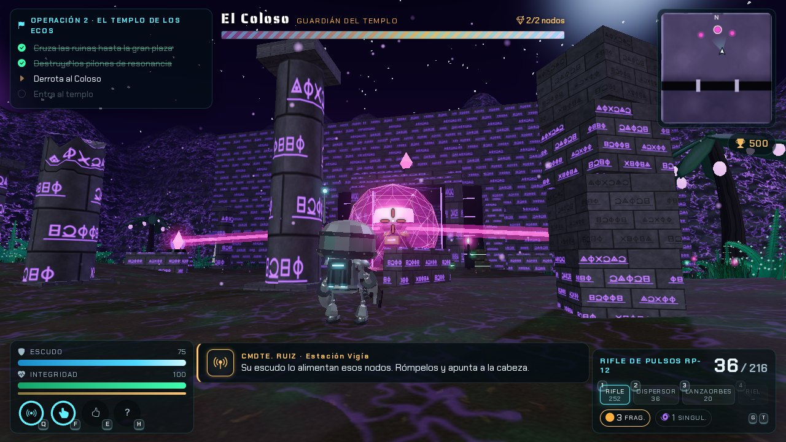 |
| 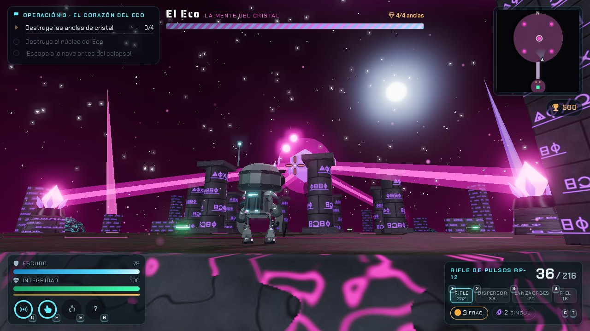 | 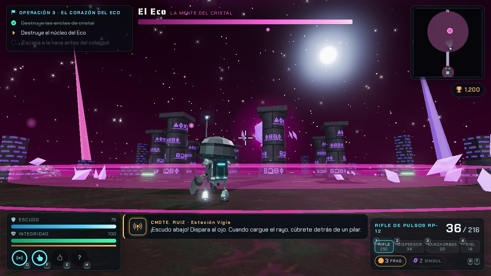 |
| 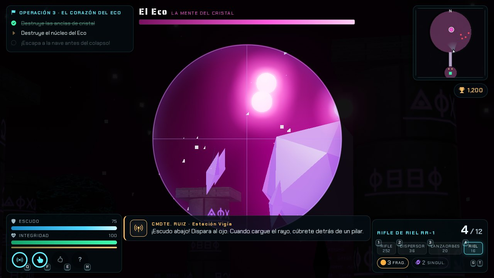 | 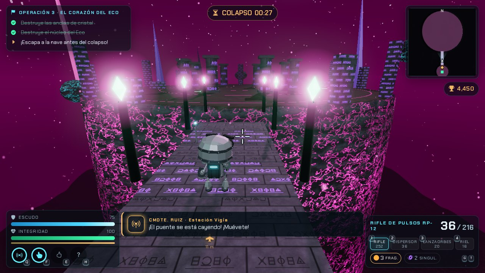 |
| 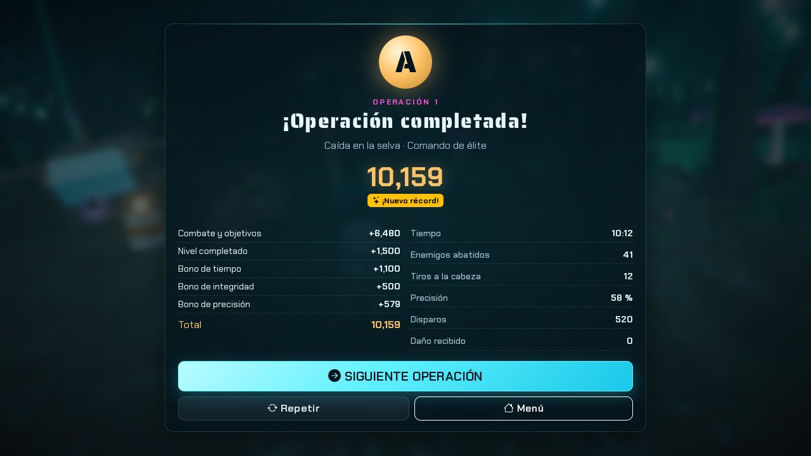 | 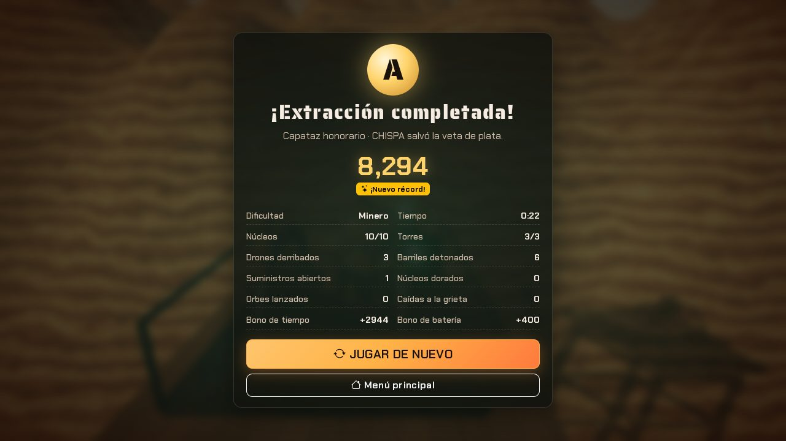 |
| 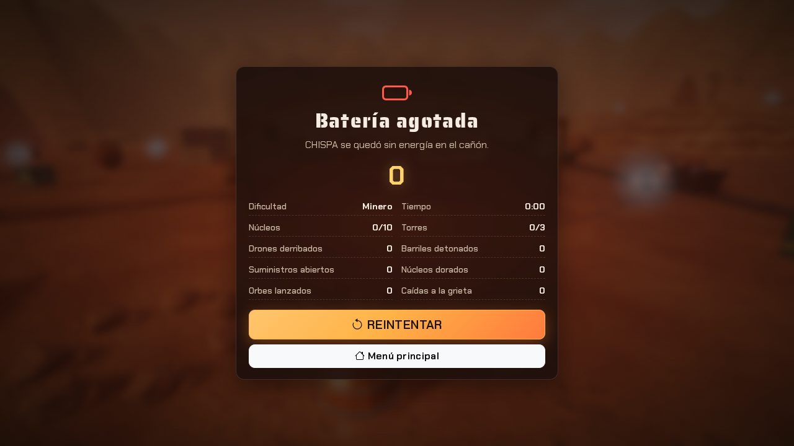 | 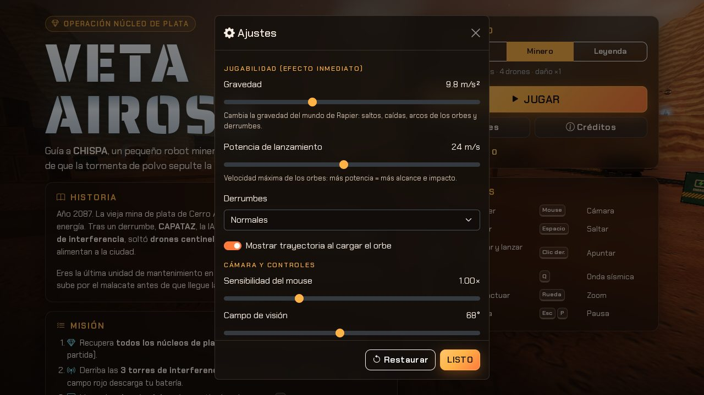 |
| 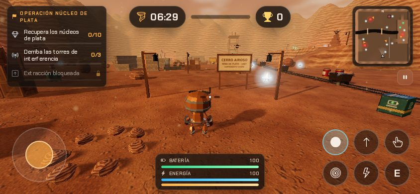 | 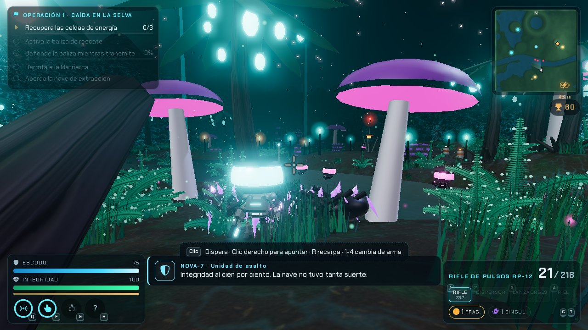 |
