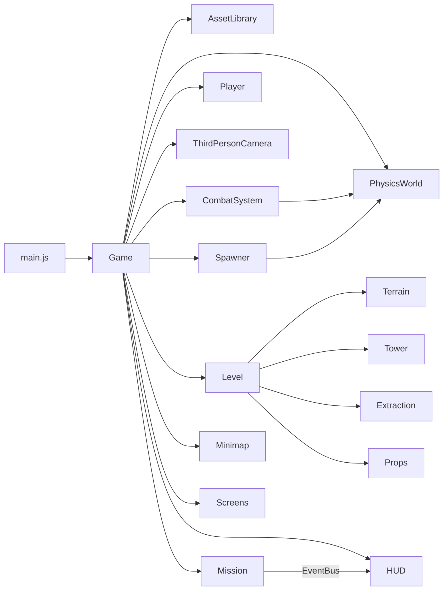
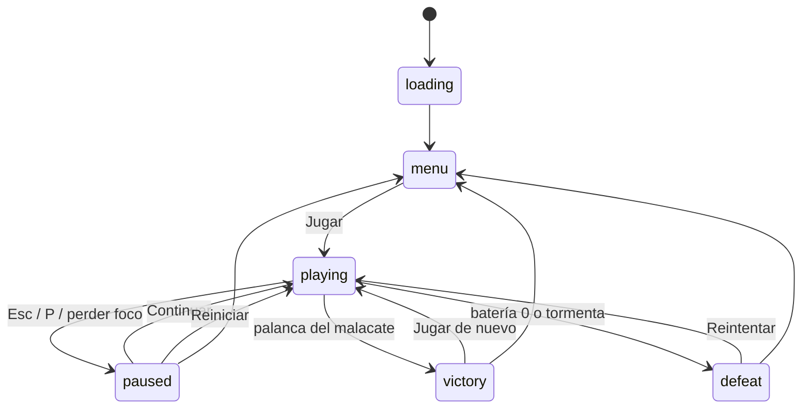
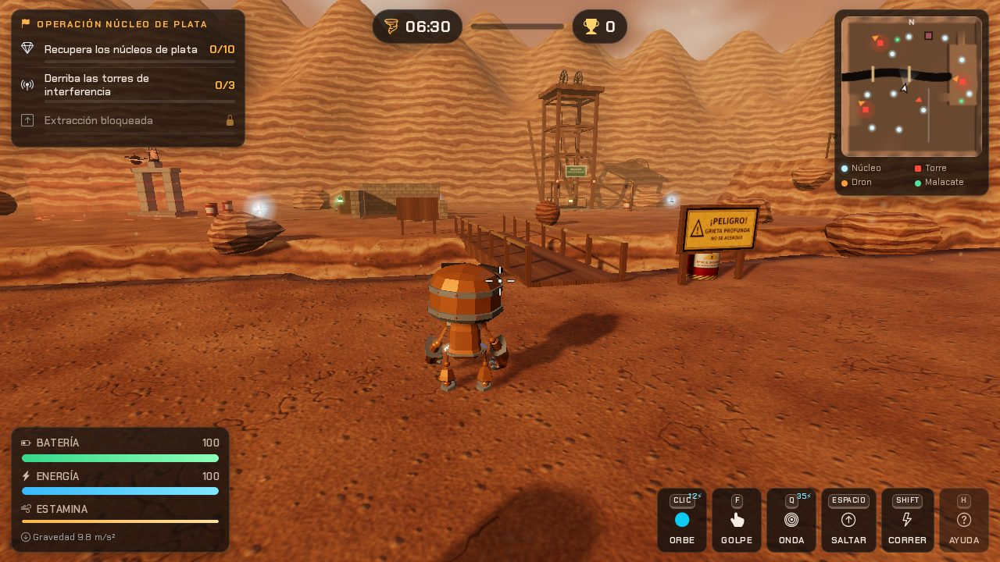
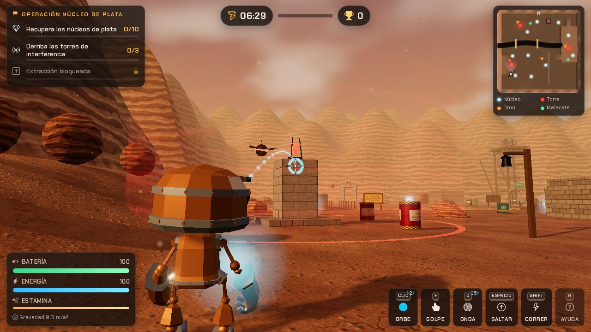

# VETA AIROSA · Operación Núcleo de Plata


Videojuego 3D en tercera persona para la Web. Controlas a **CHISPA**, un pequeño robot minero, en el cañón de **Cerro Airoso**: recuperas núcleos de plata, derribas torres de interferencia con física real y escapas por el malacate antes de que la tormenta de polvo sepulte la mina.

- **Demo (después de publicarlo):** `https://<tu-usuario>.github.io/veta-airosa/`
- **Autor:** Fernando Rosales Tello — Ingeniería en Tecnologías de la Información y Comunicaciones, TecNM campus Pachuca.
- **Sin herramientas de compilación:** HTML + CSS + JavaScript (módulos ES). Three.js y Rapier se cargan desde CDN mediante *import maps*.

---

## Índice

1. [Historia](#historia)
2. [Misión, victoria y derrota](#misión-victoria-y-derrota)
3. [Controles](#controles)
4. [Mecánicas de juego](#mecánicas-de-juego)
5. [Tecnologías](#tecnologías)
6. [Arquitectura y estructura del proyecto](#arquitectura-y-estructura-del-proyecto)
7. [Física con Rapier 3D](#física-con-rapier-3d)
8. [Modelos, animaciones, texturas y audio](#modelos-animaciones-texturas-y-audio)
9. [Ejecutar en local](#ejecutar-en-local)
10. [Publicar en GitHub Pages](#publicar-en-github-pages)
11. [Cumplimiento de requisitos](#cumplimiento-de-requisitos)
12. [Pruebas realizadas](#pruebas-realizadas)
13. [Rendimiento y compatibilidad](#rendimiento-y-compatibilidad)
14. [Créditos y licencias](#créditos-y-licencias)
15. [Historial de versiones](#historial-de-versiones)

---

## Historia

> Año 2087. La vieja mina de plata de Cerro Airoso fue reconvertida en una planta de energía. Tras un derrumbe, **CAPATAZ**, la inteligencia artificial de seguridad, se corrompió: levantó **torres de interferencia**, soltó **drones centinela** y dejó dispersos los **núcleos de plata** que alimentan a la ciudad.
>
> Eres **CHISPA**, la última unidad de mantenimiento en pie. Recupera los núcleos, apaga las torres y sube por el malacate antes de que llegue la tormenta de polvo.

El escenario es **original y creado para este proyecto** (no reutiliza el de la práctica 1.5): un cañón minero al atardecer inspirado en los socavones y castilletes (malacates) de la región minera de Hidalgo.

| Zona | Qué hay |
|---|---|
| **Campamento** (sur) | Punto de inicio, tiendas, letrero de bienvenida, vía de vagonetas. |
| **Patio de maniobras** (centro) | Ruinas de la casa de máquinas, pilas de cajas, barriles explosivos, vagonetas. |
| **Cantera** (oeste) | Torre de la Cantera, rocas sobre una pendiente que pueden rodar, mirador de madera. |
| **Meseta** (este) | Torre de la Meseta sobre una plataforma elevada con rampas de acceso. |
| **Grieta** | Barranco profundo cruzado por dos puentes colgantes; caer cuesta batería. |
| **Norte** | Torre del Norte, ruinas y el **malacate** (punto de extracción). |

## Misión, victoria y derrota

**Operación Núcleo de Plata** tiene tres objetivos, visibles en el HUD con progreso en tiempo real:

1. 💎 **Recupera todos los núcleos de plata** (8, 10 o 12 según la dificultad). Aparecen en **posiciones distintas en cada partida**.
2. 📡 **Derriba las 3 torres de interferencia.** Cada torre es una estructura de bloques dinámicos con una antena en la cima; cae cuando la antena se desploma o la mayoría de sus bloques se desplazan. Su campo rojo **descarga la batería** si te acercas, así que conviene atacar a distancia.
3. ⬆️ **Activa el malacate** del norte con la tecla <kbd>E</kbd>. Solo se desbloquea cuando completaste los dos objetivos anteriores.

| Resultado | Condición |
|---|---|
| ✅ **Victoria** | Completar los tres objetivos: la plataforma del malacate sube con CHISPA (animación de baile) y aparece la pantalla de victoria con puntaje, rango y estadísticas. |
| ❌ **Derrota por batería** | La batería llega a 0 (rayos de drones, explosiones, rocas, caídas, interferencia). CHISPA reproduce la animación de muerte. |
| ❌ **Derrota por tormenta** | El contador de la tormenta de polvo llega a 0. |

**Puntuación:** núcleo +250 · núcleo dorado +400 · torre +600 · dron +150 · caja de suministros +50 · barril +25 · bono de tiempo (+8 por segundo restante) · bono de batería (+4 por punto). Rangos: **S** ≥ 9000, **A** ≥ 7000, **B** ≥ 5000, **C** el resto. El récord por dificultad se guarda en el navegador.

**Pantallas:** carga → menú principal (historia, misión, controles, dificultad, ajustes, créditos) → juego → pausa → victoria / derrota → **reinicio** completo del nivel (botones *Jugar de nuevo* / *Reintentar* / *Reiniciar misión*).

| Dificultad | Tiempo | Núcleos | Drones | Daño |
|---|---|---|---|---|
| Explorador | 8:00 | 8 | 2 | ×0.6 |
| Minero | 6:30 | 10 | 4 | ×1.0 |
| Leyenda | 5:00 | 12 | 6 | ×1.4 |

## Controles

| Tecla / botón | Acción |
|---|---|
| <kbd>W</kbd> <kbd>A</kbd> <kbd>S</kbd> <kbd>D</kbd> / flechas | Mover (relativo a la cámara) |
| Mouse | Girar la cámara (se captura el puntero al jugar) |
| <kbd>Shift</kbd> | Correr (consume estamina) |
| <kbd>Espacio</kbd> | Saltar |
| **Clic izquierdo** | Mantener: cargar el orbe (muestra la trayectoria) · Soltar: lanzarlo |
| **Clic derecho** | Apuntar sobre el hombro |
| <kbd>F</kbd> | Golpe (empuja objetos, rompe cajas, derriba drones cercanos) |
| <kbd>Q</kbd> | Onda sísmica: impulso radial de 7.5 m (35 de energía) |
| <kbd>E</kbd> | Interactuar (palanca del malacate) |
| Rueda del mouse | Zoom de cámara |
| <kbd>H</kbd> | Mostrar / ocultar ayuda |
| <kbd>Esc</kbd> / <kbd>P</kbd> | Pausa |

En pantallas táctiles aparece un **joystick virtual**, botones de acción y arrastre para girar la cámara. Los controles están visibles en el menú, en la pausa, en la barra inferior del HUD y en el panel de ayuda (<kbd>H</kbd>).

## Mecánicas de juego

### Interacciones (8 tipos)

| # | Interacción | Cómo funciona |
|---|---|---|
| 1 | **Recolectar** núcleos, núcleos dorados y baterías | Sensores de Rapier (`setSensor(true)`) que generan eventos al entrar la cápsula del jugador. |
| 2 | **Lanzar orbes de energía** | Proyectil dinámico con CCD, velocidad inicial balística y ráfaga radial en el primer impacto. |
| 3 | **Empujar** cajas, barriles y vagonetas | El `KinematicCharacterController` aplica impulsos a los cuerpos dinámicos al caminar contra ellos. |
| 4 | **Golpe** (<kbd>F</kbd>) | Consulta de superposición esférica frente al robot + impulso a cada cuerpo encontrado. |
| 5 | **Onda sísmica** (<kbd>Q</kbd>) | Impulso radial con caída lineal según la distancia; derriba drones. |
| 6 | **Detonar barriles** | Explotan con orbes, golpes (mecha de 1.3 s), impactos fuertes o en **cadena** por otras explosiones. |
| 7 | **Romper cajas de suministros** | Se fragmentan en tablas con física y sueltan una batería. |
| 8 | **Activar la palanca** del malacate (<kbd>E</kbd>) | Plataforma cinemática que eleva al jugador para la extracción. |

### Objetos 3D con física (9 tipos)

Cajas de madera · cajas de suministros · barriles explosivos · rocas rodantes (con derrumbes aleatorios) · vagonetas mineras · bloques de piedra · antenas de las torres · drones (cinemáticos que al ser derribados pasan a dinámicos) · orbes de energía y rayos enemigos.

### Estructuras derribables

Tres torres con diseños distintos, formadas por cuerpos dinámicos apilados sobre un cimiento estático:

- **Torre de la Cantera:** 7 capas cruzadas de tablones de piedra (21 bloques) + antena.
- **Torre de la Meseta:** pirámide de 10 cajas + antena.
- **Torre del Norte:** dos pilares de cubos, dintel y remate (10 bloques) + antena.

Se derriban con orbes, golpes, explosiones de barriles cercanos o empujando las rocas de la cantera cuesta abajo.

### Generación dinámica en posiciones válidas

`Spawner.js` coloca núcleos, baterías, núcleos dorados (cada 50 s, duran 28 s) y derrumbes (con aviso rojo en el suelo) solo si el punto:

1. está dentro del área jugable y lejos de la grieta;
2. un **raycast vertical** toca terreno o estructura fija (no una caja);
3. la **normal** es casi horizontal (terreno transitable) y la altura es razonable;
4. una **esfera de holgura** no se superpone con ningún collider;
5. respeta distancias mínimas al jugador, a otros objetos, a las torres y al malacate.

### Parámetros configurables desde la interfaz (Ajustes)

| Parámetro | Efecto real |
|---|---|
| **Gravedad** (2 – 25 m/s²) | Cambia `world.gravity` de Rapier en caliente: saltos, caídas, arcos de los orbes, rodado de rocas. El HUD muestra el valor actual. |
| **Potencia de lanzamiento** (10 – 40 m/s) | Velocidad máxima de los orbes → alcance e impulso. |
| **Derrumbes** | Frecuencia de rocas que caen cerca del jugador (desactivados / pocos / normales / frecuentes). |
| **Dificultad** | Tiempo, número de núcleos y drones, cadencia de disparo y multiplicador de daño. |
| Sensibilidad, campo de visión, invertir eje Y, sombras, *bloom*, trayectoria y volumen | Cámara, render y audio. |

Los ajustes se guardan en `localStorage` (si el navegador lo permite).

## Tecnologías

| Tecnología | Versión | Uso |
|---|---|---|
| [Three.js](https://threejs.org) | 0.170.0 | Render WebGL 2, `GLTFLoader`, `AnimationMixer`, `SkeletonUtils`, `EffectComposer` + `UnrealBloomPass`, shaders personalizados. |
| [Rapier 3D](https://rapier.rs) (`@dimforge/rapier3d-compat`) | 0.14.0 | Gravedad, cuerpos rígidos (dinámicos, fijos, cinemáticos), colliders (trimesh, envolvente convexa, cápsula, cilindro, esfera, caja), sensores, CCD, eventos de colisión, impulsos, controlador de personaje. |
| [Bootstrap](https://getbootstrap.com) | 5.3.3 | HUD, pantallas, modales, formularios de ajustes, diseño responsivo. |
| [Bootstrap Icons](https://icons.getbootstrap.com) | 1.11.3 | Iconografía de la interfaz. |
| Web Audio API | nativa | Efectos de sonido sintetizados en tiempo real. |
| Canvas 2D | nativa | Minimapa. |
| Python + NumPy/SciPy/Pillow | — | Generación de texturas (`tools/generate_textures.py`). |
| Node.js + `GLTFExporter` | — | Exportación de `props.glb` (`tools/build-props.mjs`). |

**Import map** (en `index.html`):

```html
<script type="importmap">
{
  "imports": {
    "three": "https://cdn.jsdelivr.net/npm/three@0.170.0/build/three.module.js",
    "three/addons/": "https://cdn.jsdelivr.net/npm/three@0.170.0/examples/jsm/",
    "@dimforge/rapier3d-compat": "https://cdn.jsdelivr.net/npm/@dimforge/rapier3d-compat@0.14.0/rapier.es.js"
  }
}
</script>
```

La versión *compat* de Rapier trae el WebAssembly embebido en base64, por lo que funciona en GitHub Pages sin configurar tipos MIME.

## Arquitectura y estructura del proyecto

```
veta-airosa/
├── index.html                  # Estructura, import map, HUD y pantallas
├── css/
│   ├── fonts.css               # Tipografías locales (OFL)
│   ├── main.css                # Identidad visual, tokens y componentes base
│   ├── hud.css                 # HUD, minimapa, mira, controles táctiles (responsivo)
│   └── screens.css             # Carga, menú, pausa, victoria y derrota
├── js/
│   ├── main.js                 # Punto de entrada
│   ├── config.js               # Constantes, grupos de colisión y dificultades
│   ├── core/
│   │   ├── Game.js             # Orquestador: render, bucle, estados, reinicio
│   │   ├── AssetLibrary.js     # GLTFLoader, texturas y materiales
│   │   ├── Input.js            # Teclado, mouse (pointer lock), táctil
│   │   ├── Settings.js         # Parámetros configurables + récords
│   │   └── EventBus.js         # Publicador/suscriptor
│   ├── physics/PhysicsWorld.js # Rapier: paso fijo, eventos, raycasts, impulsos
│   ├── world/
│   │   ├── Terrain.js          # Terreno por función de altura + trimesh + shader
│   │   ├── Environment.js      # Cielo, sol, sombras, niebla y tormenta de polvo
│   │   ├── Level.js            # Construcción del escenario y zonas
│   │   └── PropFactory.js      # Modelos procedurales (fuente de props.glb)
│   ├── entities/
│   │   ├── Entity.js           # Clases base Entity / PhysicsEntity
│   │   ├── Player.js           # CHISPA: GLTF + AnimationMixer + KCC
│   │   ├── Props.js            # Cajas, suministros, barriles, rocas, vagonetas, bloques
│   │   ├── Pickups.js          # Núcleos, núcleos dorados y baterías (sensores)
│   │   ├── Projectiles.js      # Orbes de energía y rayos de drones
│   │   ├── Drone.js            # IA de drones + escuadrón con reaparición
│   │   ├── Tower.js            # Torres derribables y campo de interferencia
│   │   └── Extraction.js       # Malacate con plataforma cinemática
│   ├── camera/ThirdPersonCamera.js
│   ├── gameplay/
│   │   ├── CombatSystem.js     # Orbe, golpe, onda, explosiones, trayectoria
│   │   ├── Spawner.js          # Generación dinámica en posiciones válidas
│   │   └── Mission.js          # Objetivos, tiempo, puntaje, victoria/derrota
│   ├── fx/
│   │   ├── Effects.js          # Partículas, destellos, ondas, avisos
│   │   └── AudioManager.js     # Audio procedural (Web Audio)
│   └── ui/
│       ├── HUD.js · Minimap.js · Screens.js · TouchControls.js
├── assets/
│   ├── models/                 # RobotExpressive.glb (CC0) y props.glb (generado)
│   ├── textures/               # Texturas generadas (albedo + normales)
│   ├── fonts/                  # Chakra Petch y Saira Stencil One (OFL)
│   └── img/                    # Logo, favicon y portada
├── docs/screenshots/           # Capturas para este README
├── tools/                      # Scripts para regenerar texturas y props.glb
├── .github/workflows/pages.yml # Publicación automática en GitHub Pages
├── PUBLICAR.md                 # Guía paso a paso de GitHub + Pages
├── package.json · .editorconfig · .gitignore · .nojekyll · LICENSE
└── README.md
```

### Programación orientada a objetos

- `Entity` → `PhysicsEntity` → `Crate`, `SupplyCrate`, `Barrel`, `Boulder`, `MineCart`, `StoneBlock`, `Beacon`, `EnergyOrb`, `EnemyBolt`, `Drone`.
- `Entity` → `Pickup` → `SilverCore`, `GoldCore`, `BatteryPickup`; `Entity` → `Player`, `Extraction`.
- Sistemas independientes que se comunican con `EventBus`: `Mission` emite eventos y `HUD` / `AudioManager` / `Effects` reaccionan.



### Estados del juego



### Bucle principal (por cuadro)

1. Entrada (cámara, pausa, ayuda, interacción).
2. Física con **paso fijo de 1/60 s** (acumulador, máx. 4 subpasos): `fixedUpdate` de jugador, drones y plataforma → `world.step()` → despacho de eventos de colisión.
3. Eliminación diferida de entidades, `update` de entidades, **interpolación** visual entre pasos.
4. Combate, misión, drones, generación dinámica, tormenta.
5. Cámara, entorno, partículas, HUD, minimapa y render (con *bloom* opcional).

## Física con Rapier 3D

| Elemento | Implementación |
|---|---|
| Gravedad | `new RAPIER.World({x:0, y:-g, z:0})`, modificable desde Ajustes. |
| Terreno | Collider **trimesh** con exactamente los mismos triángulos que la malla visual. |
| Rocas decorativas | Colliders de **envolvente convexa** (`convexHull`). |
| Jugador | Cuerpo cinemático + cápsula + `KinematicCharacterController` (pendiente máxima 52°, auto-escalón, pegado al suelo, empuje de cuerpos dinámicos). |
| Objetos | Cuerpos dinámicos con densidad, fricción y restitución propias; nacen dormidos para que las pilas sean estables. |
| Proyectiles | Dinámicos con **CCD** para no atravesar objetos a alta velocidad. |
| Drones | `kinematicPositionBased`; al ser derribados: `setBodyType(Dynamic)`, caen y explotan. |
| Coleccionables | **Sensores** con `ActiveCollisionTypes.KINEMATIC_FIXED` para detectar la cápsula cinemática. |
| Eventos | `EventQueue` + `ActiveEvents.COLLISION_EVENTS` → `onCollide()` de cada entidad. |
| Impulsos | `applyImpulse`, `applyTorqueImpulse`, impulso radial con caída lineal (explosiones, onda, ráfaga del orbe). |
| Consultas | `castRayAndGetNormal` (mira, cámara, validación de spawns) e `intersectionsWithShape` (golpe, explosiones, holgura). |

**Grupos de colisión** (`config.js`): `WORLD`, `PLAYER`, `PROP`, `ORB`, `BOLT`, `DRONE`, `PICKUP`, `DEBRIS`. Así, por ejemplo, los orbes del jugador no chocan con él mismo, los rayos enemigos no golpean a los drones y los fragmentos no estorban al caminar.

## Modelos, animaciones, texturas y audio

### Personaje y animaciones (`AnimationMixer`)

El personaje es `RobotExpressive.glb` cargado con `GLTFLoader` y clonado con `SkeletonUtils` (para reiniciar sin recargar). Se usan **8 animaciones** con fundidos cruzados y sincronización de fase entre caminar y correr:

| Estado | Clip | Cuándo |
|---|---|---|
| Idle | `Idle` | Quieto |
| Walk | `Walking` | Velocidad baja (se ajusta la velocidad de reproducción) |
| Run | `Running` | Corriendo con <kbd>Shift</kbd> |
| Acción | `Punch` | Lanzar orbe y golpe |
| Acción | `Jump` | Salto, caída y onda sísmica |
| Acción | `Death` | Derrota |
| Acción | `Dance` | Victoria (extracción) |
| Acción | `Wave` | Menú y al activar la palanca |

Además se usan los *morph targets* faciales del modelo (`Surprised` al recibir daño y `Sad` al perder).

### Utilería 3D (`props.glb`)

`tools/build-props.mjs` construye por código los modelos de `js/world/PropFactory.js` (núcleo de plata, batería, dron, vagoneta, antena, farol, palanca y tienda) y los exporta con `GLTFExporter`. El juego carga `props.glb` con `GLTFLoader`; si el archivo faltara, usa `PropFactory` como respaldo.

### Texturas

`tools/generate_textures.py` genera 19 texturas *tileables* (albedo + mapas normales): suelo, roca estratificada, bloques de piedra, muro de piedra, tablones, cajas, cajas de suministros, barriles, metal oxidado y tres letreros. El terreno usa un **shader propio** (`onBeforeCompile`) que mezcla suelo y roca según la pendiente, con proyección triplanar en paredes, oscurecimiento en la grieta y mapa normal en zonas planas.

### Audio

Todos los sonidos (lanzamiento, impactos, explosiones, recolección, drones, pasos, palanca, alarmas, viento de la tormenta, victoria y derrota) se **sintetizan con Web Audio**: no hay archivos de audio ni problemas de derechos. Incluye atenuación por distancia y paneo estéreo.

### Regenerar recursos (opcional)

```bash
# Texturas (requiere Python 3 con numpy, scipy y pillow)
python tools/generate_textures.py

# props.glb (requiere Node.js 18+)
npm run props
```

## Ejecutar en local

Los módulos ES y los GLB **no funcionan abriendo `index.html` con doble clic** (`file://`); el juego lo detecta y muestra instrucciones. Usa cualquier servidor estático:

- **VS Code:** clic derecho en `index.html` → *Open with Live Server*.
- **Node.js:** `npx http-server . -p 8080 -c-1` (o `npm start`) y abre `http://localhost:8080`.
- **Python:** `python -m http.server 8080` y abre `http://localhost:8080`.

Se necesita conexión a Internet para descargar Three.js, Rapier y Bootstrap desde jsDelivr (quedan en caché del navegador). Agrega `?debug` a la URL para exponer `window.game` en la consola.

## Publicar en GitHub Pages

Resumen (la guía completa, con capturas de qué pulsar y solución de problemas, está en **[PUBLICAR.md](PUBLICAR.md)**):

```bash
cd veta-airosa
git remote add origin https://github.com/<tu-usuario>/veta-airosa.git
git push -u origin main
```

1. Crea el repositorio **público** `veta-airosa` en GitHub (sin README ni licencia, para no crear conflictos).
2. Sube el proyecto con los comandos anteriores (el historial de commits ya viene incluido).
3. En **Settings → Pages → Build and deployment → Source** elige **GitHub Actions**. El flujo `.github/workflows/pages.yml` publica el sitio en cada `push` a `main`.
4. Tu juego quedará en `https://<tu-usuario>.github.io/veta-airosa/`.

Todas las rutas del proyecto son **relativas**, por lo que funciona tanto en la raíz de un dominio como en la subcarpeta `/veta-airosa/` de GitHub Pages.

## Cumplimiento de requisitos

| Requisito | Implementación | Archivo(s) |
|---|---|---|
| Three.js por CDN e import maps | Import map con Three.js r170 y addons desde jsDelivr | `index.html` |
| GLTFLoader | Robot animado y `props.glb` | `core/AssetLibrary.js` |
| AnimationMixer con ≥ 4 animaciones | 8 clips con fundidos y acciones únicas | `entities/Player.js` |
| Cámara en tercera persona con mouse | Órbita con pointer lock, zoom, modo apuntar, colisión y sacudidas | `camera/ThirdPersonCamera.js` |
| Rapier: gravedad, cuerpos, colliders, colisiones, impulsos | Mundo con paso fijo, 6 tipos de collider, eventos, CCD, impulsos | `physics/PhysicsWorld.js` y entidades |
| Personaje controlable con teclado | Caminar, correr, saltar, atacar con KCC | `entities/Player.js` |
| Escenario propio con iluminación, materiales, texturas y obstáculos | Cañón minero, cielo por shader, sol con sombras, niebla, 19 texturas | `world/*` |
| ≥ 4 tipos de objetos con física | 9 tipos | `entities/Props.js`, `Pickups.js`, `Projectiles.js`, `Drone.js` |
| Estructura derribable | 3 torres de bloques dinámicos con detección de derrumbe | `entities/Tower.js` |
| Lanzamiento / disparo / ataque | Orbes balísticos con carga y trayectoria, golpe, onda sísmica | `gameplay/CombatSystem.js` |
| ≥ 3 tipos de interacción | 8 tipos (ver tabla) | varios |
| Parámetro configurable que cambia el juego | Gravedad, potencia, derrumbes, dificultad… | `core/Settings.js`, `ui/Screens.js` |
| Generación dinámica en posiciones válidas | Raycast + normal + holgura + distancias | `gameplay/Spawner.js` |
| Misión con objetivos, progreso y puntuación | 3 objetivos, tiempo, puntaje, rango | `gameplay/Mission.js`, `ui/HUD.js` |
| Victoria y derrota | Extracción / batería 0 / tormenta | `gameplay/Mission.js` |
| Pantallas de inicio, victoria, derrota y reinicio | Menú, pausa, resultados; reconstrucción completa del nivel | `ui/Screens.js`, `core/Game.js` |
| HUD moderno, controles visibles, responsivo con Bootstrap 5 | HUD, minimapa, barra de acciones, ayuda, modales, móvil | `index.html`, `css/*`, `ui/*` |
| Código organizado y POO | 30 módulos ES con clases | `js/` |
| Repositorio, commits y GitHub Pages | Historial de commits incluido + flujo de Actions | `.git/`, `.github/workflows/pages.yml`, `PUBLICAR.md` |
| README completo | Este documento | `README.md` |

## Pruebas realizadas

El proyecto se probó en **Chromium 141 sin interfaz** (render por software SwiftShader) sirviendo exactamente las mismas versiones de las librerías que usa el import map. Se verificó con scripts automatizados:

- carga sin errores en consola y llegada al menú; el robot y la utilería se cargan desde `RobotExpressive.glb` y `props.glb` con `GLTFLoader`;
- movimiento, carrera, salto y cambio de animaciones (`Walking`, `Running`, `Jump`);
- recolección de núcleos por sensor, empuje de vagonetas al caminar, golpe que rompe cajas de suministros y suelta baterías;
- derribo de las **3 torres** con 1–2 orbes cargados lanzados desde fuera del campo de interferencia;
- drones que detectan, persiguen y disparan; derribo con orbe y con onda sísmica;
- explosiones en cadena, caída a la grieta con reaparición, derrumbes con aviso;
- cambio de **gravedad** desde el control deslizante (se refleja en `world.gravity` y en el HUD) y de potencia de lanzamiento;
- flujo completo: 10/10 núcleos → 3/3 torres → malacate → **victoria**; derrota por batería; derrota por tormenta; reinicio y regreso al menú;
- diseño en 1280×720, 1024×600, 844×390 (táctil horizontal) y 390×844 (táctil vertical).

> Nota honesta: las pruebas se hicieron en un navegador automatizado con render por software, donde la tasa de cuadros no es representativa. En una computadora con GPU el juego está pensado para 60 FPS. Si notas lentitud, desactiva *sombras* o *bloom* en Ajustes.

## Rendimiento y compatibilidad

- Navegadores con **WebGL 2**: Chrome, Edge, Firefox y Safari recientes.
- Recomendado: mouse y teclado. En tabletas y teléfonos funciona con controles táctiles.
- Optimizaciones: paso de física fijo con interpolación, cuerpos que duermen, luces de explosión de un *pool* fijo (sin recompilar shaders), partículas en un solo `THREE.Points`, geometrías compartidas, sombra que sigue al jugador, límite de *pixel ratio* (1.75).

## Créditos y licencias

| Recurso | Autor | Licencia |
|---|---|---|
| Código del juego | Fernando Rosales Tello | MIT (`LICENSE`) |
| `RobotExpressive.glb` | [Tomás Laulhé (Quaternius)](https://www.patreon.com/quaternius), modificaciones de [Don McCurdy](https://donmccurdy.com/) (repositorio de ejemplos de Three.js) | CC0 1.0 |
| `props.glb`, texturas, letreros, logo | Generados por procedimiento para este proyecto | CC0 1.0 |
| Three.js | three.js authors | MIT |
| Rapier 3D | Dimforge | Apache-2.0 |
| Bootstrap y Bootstrap Icons | The Bootstrap Authors | MIT |
| Chakra Petch, Saira Stencil One | Google Fonts (vía Fontsource) | SIL OFL 1.1 (`assets/fonts/OFL.txt`) |
| Efectos de sonido | Sintetizados en tiempo real con Web Audio | — |

## Historial de versiones

El repositorio incluye el historial de desarrollo en commits por funcionalidad (`git log --oneline`):

1. Estructura inicial y configuración.
2. Texturas procedurales y modelos GLB.
3. Núcleo (configuración, eventos, ajustes, entrada, carga de recursos).
4. Física con Rapier (paso fijo, interpolación, eventos).
5. Escenario del cañón (terreno, grieta, meseta, puentes, atardecer).
6. Personaje con GLTF, animaciones y cámara en tercera persona.
7. Objetos con física, coleccionables y proyectiles.
8. Torres derribables, drones y malacate.
9. Combate, generación dinámica y misión.
10. Partículas y audio procedural.
11. HUD, minimapa, pantallas, ajustes y controles táctiles.
12. Correcciones tras pruebas, pulido visual y balance.
13. Documentación y publicación en GitHub Pages.

## Capturas

| | |
|---|---|
|  |  |
|  |  |
|  |  |
|  |  |
